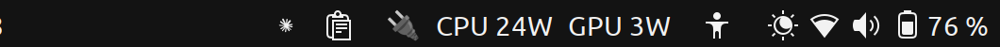

# Essentials

A GNOME Shell extension for Ubuntu 22.04 (GNOME 42) that collects a few small things I wanted in my desktop. Each feature can be switched on or off on its own.



| Feature | What it does |
|---|---|
| **Power monitor** | Live battery charge/discharge, CPU and GPU watts and network speed in the top bar. Click it for temperatures, fan speeds, the busiest apps on CPU and GPU, memory and the CPU power limit. Also adds battery health, charge cycles, time remaining and a **Limit charge to 80%** switch to GNOME's own battery menu. |
| **Recent files** (`Super+R`) | Your latest downloads, screenshots and recently opened files in one menu. A new download or screenshot appears in the top bar for a few minutes: click to open it (or copy the screenshot). **Quick look**: hover a row (or press Space) to preview images, PDFs, videos, Office documents, text and archives. **Drag** a row straight into Chrome, a chat or a folder. Per-row buttons: open with, show in Files, copy file, copy path, move to trash. |
| **Clipboard history** (`Super+V`) | Everything you copy this session (text and images), like Windows' Win+V. Choosing an item pastes it into the window you were in. Pin items to keep them across restarts. Copies made in password managers are skipped. |
| **Display layout** | Remembers monitor arrangements per set of monitors and restores them when you plug in, even when the GPU renames ports (common on hybrid-graphics laptops). **External Only** turns the laptop screen off; **Join Displays** brings it back exactly where it was. In the system menu. |

There is also an **Essentials** app in the app grid that opens the settings: one switch per feature plus each feature's options.

## Requirements

- Ubuntu 22.04 / **GNOME Shell 42**. Tested on X11. Most of it should work on Wayland, but dragging files out of the menu and window placement are X11-specific and untested there.
- `gjs` and `glib-compile-schemas` (installed by default on Ubuntu).
- Optional, for richer previews: `ffmpeg` (video frames), `poppler-utils` (PDF page count), `unzip`, `libreoffice-core` (Office documents), `gnome-sushi` (not needed, but gives Space-to-preview in the Files app too).
- Optional: an NVIDIA GPU with `nvidia-smi` for GPU watts and per-app GPU use. Without it the GPU reading is simply hidden.

## Install

```bash
git clone https://github.com/harshkchhajed/essentials-gnome.git
cd essentials-gnome
./install.sh
```

Then restart GNOME Shell (X11: <kbd>Alt</kbd>+<kbd>F2</kbd>, type `r`, <kbd>Enter</kbd>; Wayland: log out and in) and enable it:

```bash
gnome-extensions enable essentials@harsh
```

**Super+V**: GNOME uses Super+V to open the notification list (Super+M does the same). To use Super+V for clipboard history, run the installer with `./install.sh --super-v`, or set it yourself:

```bash
gsettings set org.gnome.shell.keybindings toggle-message-tray "['<Super>m']"
```

To update, `git pull` and run `./install.sh` again, then restart GNOME Shell.

## Optional: the power service (Lenovo Legion only)

`power-service/` contains `usbc-power-cap`, a small root service written for the **Lenovo Legion Pro 5 (16IRX9)**. It:

- detects the charger from the embedded controller and, on a weak USB-C charger (e.g. 65 W), adapts the CPU power limit so the charger stops cutting in and out under load; on the full-power barrel charger it restores the factory limits, and it restores them whenever the service stops;
- writes fan speeds to `/run/legion-fans` for the power monitor;
- lets admin users (the `sudo` group) read CPU energy (for CPU watts) and toggle Lenovo Conservation Mode (the **Limit charge to 80%** switch).

```bash
sudo ./power-service/install.sh      # install / update
sudo ./power-service/uninstall.sh    # remove
```

On other laptops, don't install it as-is: it reads Legion-specific controller registers. Read the script first. Essentials works without it; you just won't see CPU watts, fan speeds or the charge-limit switch.

## Settings

Open **Essentials** from the app grid (or the **Settings** row at the bottom of the Recent Files menu, or the Extensions app):

- **Features**: switch each feature on or off; changes apply immediately.
- **Recent Files**: hover delay for quick look (0 turns hover off; Space still works), files per section, show/hide Screenshots and Recently opened, how long new files stay in the top bar.
- **Clipboard**: paste after choosing an item.

Shortcuts can be changed with `gsettings`:

```bash
S="--schemadir $HOME/.local/share/gnome-shell/extensions/essentials@harsh/schemas"
gsettings $S set org.gnome.shell.extensions.essentials recent-files-shortcut "['<Super>r']"
gsettings $S set org.gnome.shell.extensions.essentials clipboard-shortcut "['<Super>v']"
```

## Privacy

- Clipboard history lives in memory; images go to `$XDG_RUNTIME_DIR/clipboard-history` (cleared at logout). Only **pinned** text is written to disk, in `~/.config/clipboard-history-pins.json` (readable only by you).
- Copies made while a password manager is focused (KeePassXC, Bitwarden, 1Password, …) or flagged by it are not recorded. Passwords copied from a browser's password manager can't be told apart from normal text; remove them from the history with the 🗑 button.
- Quick look renders files locally. LibreOffice runs without network access and ffmpeg may only read local files, so previewing a document can't contact anything.

## Troubleshooting

- **Something doesn't work**: GNOME Shell logs extension errors to the system journal:
  ```bash
  journalctl -b _COMM=gnome-shell | grep -i -A5 essentials
  ```
- **A feature failed to start**: you get a notification; the other features keep working. Turn it off and on in Settings to retry.
- **Top bar is crowded**: the power monitor hides its network and then GPU readings rather than letting other indicators (like the battery percentage) get cut off.
- **Saved a wrong display layout**: system menu → Display Layout → **Forget Saved Layout**.

## How it's built

```
essentials@harsh/
  extension.js          starts/stops each feature from its on/off setting
  prefs.js              settings window
  features/
    power.js            top-bar power monitor + battery menu additions
    recentFiles.js      recent files menu
    preview.js          quick-look card
    clipboard.js        clipboard history
    displayLayout.js    monitor layouts (Mutter DisplayConfig D-Bus API)
    tooltip.js          hover labels for icon buttons
    scrollMenu.js       scrolling sections for long menus
  helpers/              small separate processes, so slow work never blocks the shell
    peek.js             thumbnails and details for quick look
    drag-file.js        carries a file dragged out of the menu into other apps
    copy-file.js        puts a file on the clipboard the way file managers do
  schemas/              settings
power-service/          optional root service (Lenovo Legion)
```

Every feature module exports `enable(settings)` and `disable()`. Anything that touches the disk or other programs runs asynchronously or in a helper process, because a blocking call inside GNOME Shell freezes the whole desktop.

## Uninstall

```bash
./uninstall.sh
```

Saved display layouts and clipboard pins are kept in `~/.config`; delete them by hand if you like.

## License

GPL-2.0-or-later. See [LICENSE](LICENSE).
